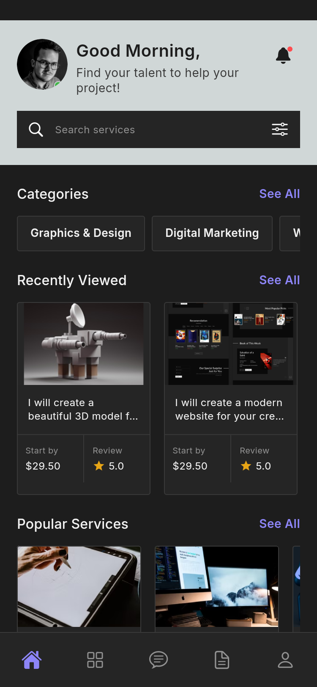
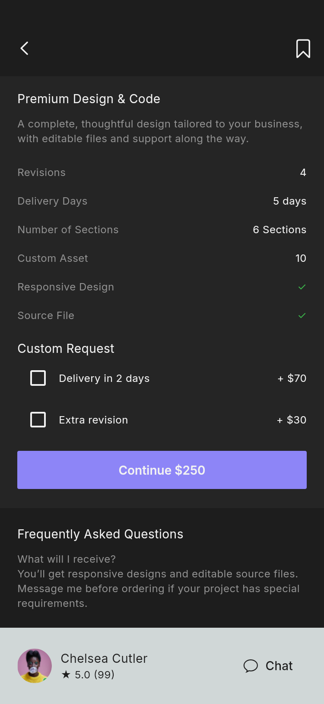
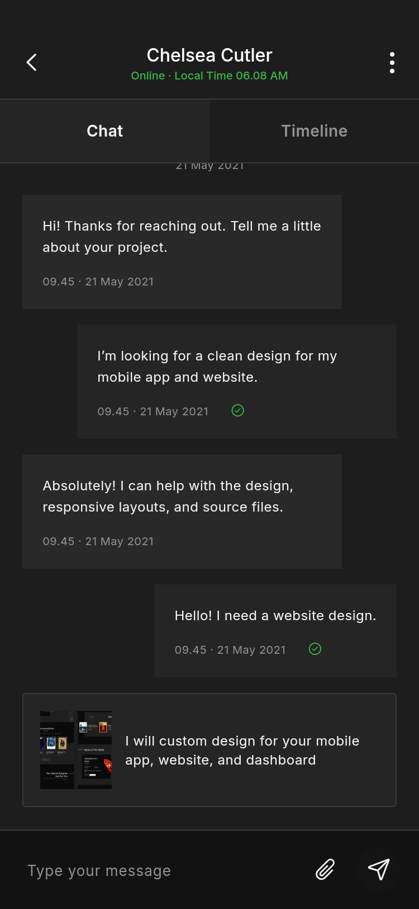
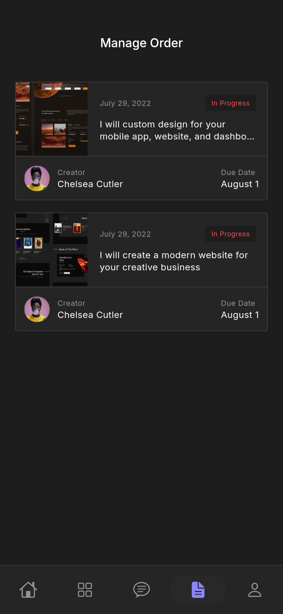
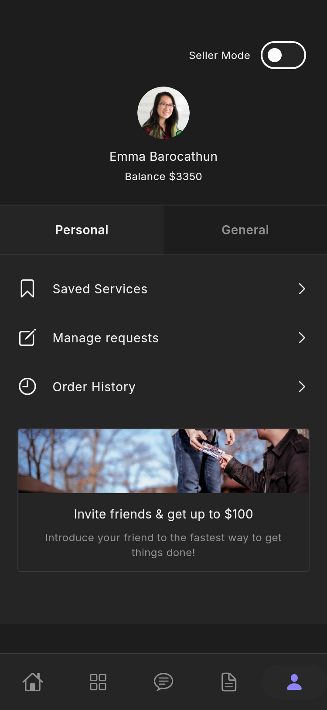
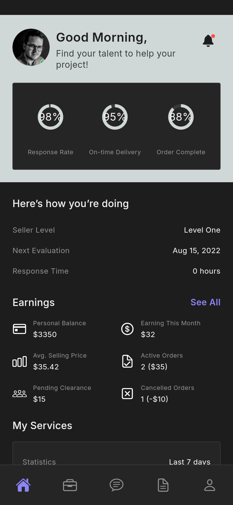
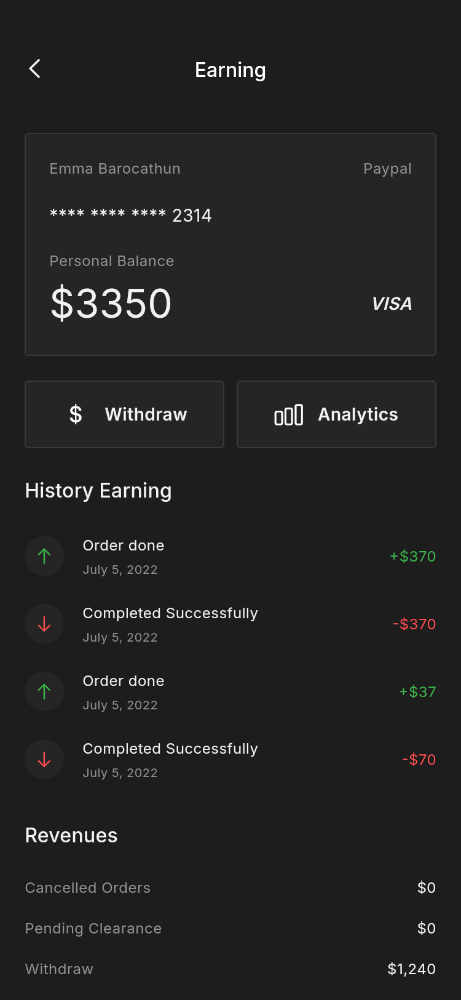
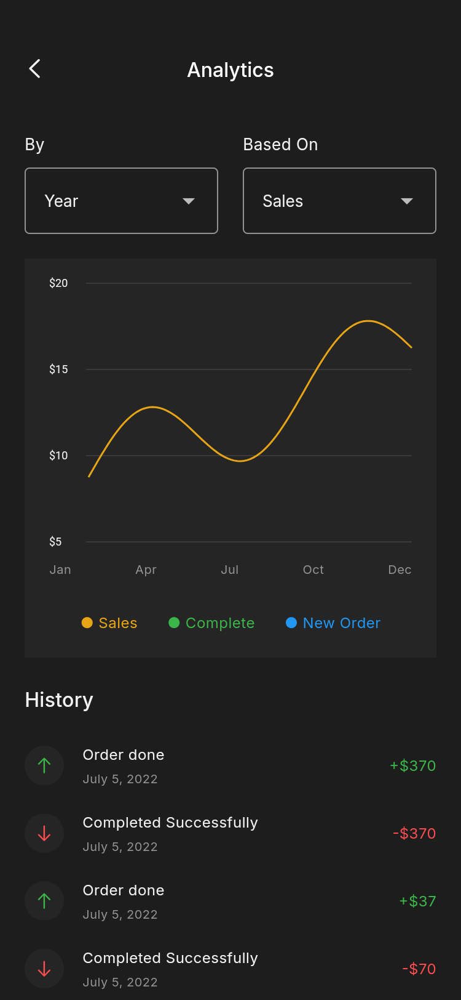
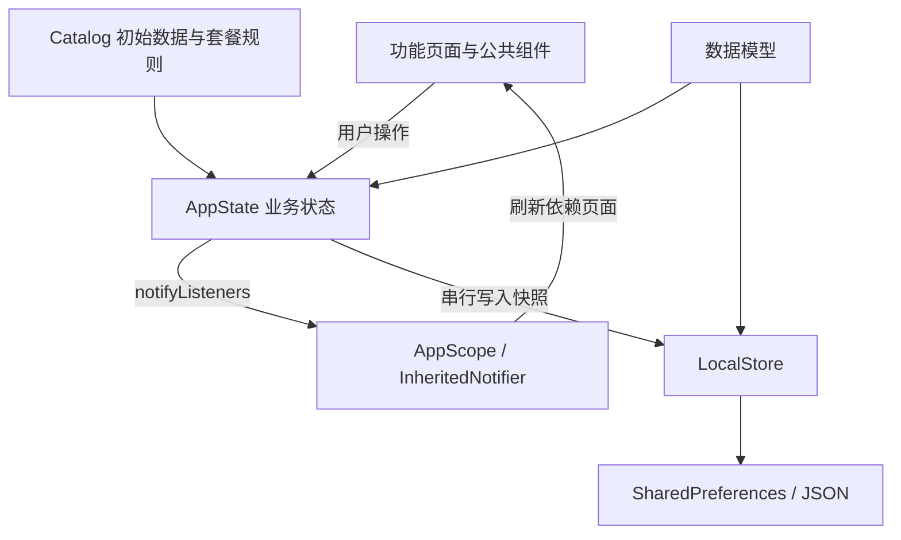

# Pixelz 项目结构与架构说明

## 1. 项目定位

Pixelz 是一个连接买家与自由职业者的服务平台 Flutter 应用。买家可发现设计、开发、营销等服务，选择套餐、填写需求并创建订单；卖家可浏览项目需求、发送报价、发布服务并查看收益。

本项目从 Pixso 实际读取页面结构、颜色、文字样式和图片素材，采用 Flutter 原生组件重建页面及交互，并非整张设计图铺底。界面使用原稿的英文文案，交付文档使用中文。

当前范围：离线可交互原型。没有远程服务器；不执行真实支付、提现、邮件验证或文件上传。应用内已经明确标注这些演示环节。

## 2. 主要界面

下图均为应用在 Android 模拟器上的实际运行截图。完整图片见 [界面截图索引](SCREENSHOTS.md)，Pixso 原稿另存于 `design/`。

| 买家首页 | 分类浏览 | 服务套餐 |
| --- | --- | --- |
|  |  |  |

首页聚合服务入口；分类与搜索定位服务；详情页支持三个价格套餐及加急、额外修改选项，收藏按钮与个人中心共用状态。

| 即时聊天 | 订单管理 | 个人中心 |
| --- | --- | --- |
|  |  |  |

聊天内容在本机保存，订单可从进行中变为完成；个人中心包含收藏、需求管理、历史订单和卖家模式切换。

| 卖家工作台 | 收益页 | 数据分析 |
| --- | --- | --- |
|  |  |  |

卖家端提供项目需求、服务发布、报价模板和本地余额演示。分析图由 Flutter Canvas 绘制，可切换时间范围与指标。

## 3. 项目目录

```text
Pixelz/
├── lib/
│   ├── main.dart                      # 初始化本地存储，启动应用
│   ├── app.dart                       # 路由、应用容器、双模式底部导航
│   ├── core/
│   │   └── theme.dart                  # Pixso 色板、字体与组件主题
│   ├── data/
│   │   ├── models.dart                # Service / Order / ChatMessage / ProjectRequest
│   │   ├── catalog.dart               # 分类、示例服务、联系人、套餐计算
│   │   └── local_store.dart           # 本地 JSON 快照读写
│   ├── state/
│   │   └── app_state.dart             # 业务操作、状态通知、串行持久化、AppScope
│   ├── ui/
│   │   └── widgets.dart               # 页面容器、卡片、表单、列表、空态等公共组件
│   └── features/
│       ├── auth/auth.dart             # 欢迎、登录、注册、重置密码
│       ├── marketplace/marketplace.dart # 首页、分类、搜索、详情、评价、通知
│       ├── messages/messages.dart     # 会话列表、聊天、示例附件
│       ├── orders/orders.dart         # 订单、时间线、结算、成功态
│       ├── profile/profile.dart       # 个人中心、需求、设置、邀请、付款方式
│       └── seller/seller.dart         # 工作台、项目、收益、服务、报价
├── assets/
│   ├── images/                        # 从 Pixso 导出的本地 PNG 资产
│   └── fonts/                         # Inter 字体及 OFL 许可
├── test/app_state_test.dart           # 业务数据与持久化测试
├── integration_test/
│   ├── app_test.dart                  # 买家/卖家流程和界面截图
│   ├── details_test.dart              # 设置详情、卖家搜索和分阶段报价截图
│   └── layout_test.dart               # 两种手机尺寸下的全路由布局检查
├── test_driver/screenshots.dart       # 将运行截图写回 docs/screenshots
├── android/                          # Android 工程
├── ios/                              # iOS 工程
├── web/                              # Flutter Web 入口
├── docs/
│   ├── PROJECT.md                    # 本文档
│   ├── DESIGN_REFERENCE.md           # 原稿节点与实现映射
│   ├── TESTING.md                    # 测试结果及复现方式
│   ├── SCREENSHOTS.md                # 全部界面截图索引
│   ├── screenshots/                  # 应用实际运行图
│   └── design/                       # Pixso 原稿导出参考
├── artifacts/pixelz-demo.apk          # 可直接安装的 Android Release 演示包
├── pubspec.yaml / pubspec.lock        # 依赖及锁定版本
└── README.md                         # 项目入口
```

## 4. 分层与数据流



- **展示层**：业务模块中的页面只负责展示、表单校验和转发用户操作。公共组件集中管理留白、边框、文本和交互区域。
- **状态层**：`AppState` 统一处理收藏、模式切换、订单、聊天、需求、服务和余额；通过 `ChangeNotifier` 通知界面。页面内短暂状态（当前套餐、输入框、筛选条件）留在页面中。
- **数据层**：`LocalStore` 用键 `pixelz.v1` 保存 JSON 快照；模型提供序列化方法。连续操作按顺序写入，避免旧快照覆盖新快照；保存失败通过状态通知用户。
- **依赖选择**：运行期业务依赖只有 `shared_preferences`，图标使用 `cupertino_icons`。没有引入额外状态管理、路由、网络或图表库，以控制工程体积与理解成本。

这套结构适合当前演示规模。连接后端时，可将 `LocalStore` 与初始目录替换为 API 仓库，让 `AppState` 调用仓库；功能页面和公共组件可继续使用。正式登录应保存服务端令牌，不应在本地明文保存密码。

## 5. 页面与功能入口

| 模块 | 入口/路由 | 已实现行为 |
| --- | --- | --- |
| 主导航 | `/` | Home / Categories 或 Jobs / Chat / Orders / Profile；保留各标签状态 |
| 服务发现 | `/categories`、`/services`、`/search` | 分类浏览、关键词搜索、服务与卖家切换、价格/交付时间筛选、无结果空态 |
| 服务详情 | `/service`、`/seller`、`/reviews` | 图片、简介展开、套餐、额外项目、收藏、卖家资料、评价、联系入口 |
| 通知 | `/notifications` | 活动、订单更新与相关页面跳转 |
| 收藏 | `/saved` | 与详情页同步收藏，搜索、筛选与空态 |
| 聊天 | `/conversation` | 发送文字、示例附件、跳转服务与订单时间线；卖家可创建报价 |
| 订单 | `/order`、`/history` | 需求、金额、状态；买家完成订单、卖家提交交付；历史订单筛选 |
| 下单 | `/checkout`、`/success` | 需求必填、统一价格计算、创建订单、成功页与订单跳转 |
| 个人中心 | Profile 标签 | Personal / General、卖家模式、在线状态、设置与登录入口 |
| 需求 | `/requests`、`/new-request` | 空态、表单校验、发布本地需求、审批状态展示 |
| 邀请 | `/invite` | 邀请介绍、复制邀请码 |
| 设置 | `/settings`、`/preferences` | 通知偏好持久化、退出确认、设置详情 |
| 说明/反馈 | `/info`、`/feedback` | 帮助、隐私、安全、语言说明，复制反馈内容 |
| 付款方式 | `/payments` | 掩码示例卡与当前默认方式说明 |
| 卖家入口 | `/become-seller` | 切换至卖家模式 |
| 卖家收益 | `/earnings`、`/withdraw`、`/analytics` | 本地余额、金额验证、提现成功态、可切换图表与示例流水 |
| 项目机会 | `/jobs`、`/job` | 搜索项目、查看需求、发送本地报价 |
| 服务管理 | `/manage-services`、`/new-service` | 发布自定义服务；自建服务可确认删除 |
| 报价模板 | `/templates`、`/create-offer` | 固定价格或两阶段报价、保存模板、向本地聊天发送报价 |
| 账号 | `/welcome`、`/login`、`/signup`、`/reset` | 欢迎入口、输入校验、演示登录与注册、验证码/新密码/完成步骤 |

## 6. 关键规则

1. 套餐价格集中计算：基础套餐为服务起价，标准套餐为 3 倍，高级套餐为 5 倍；例如起价 $50 的参考服务对应 $50 / $150 / $250。加急 +$70，额外修改 +$30，服务费 +$5，列表、详情和结算复用同一规则。
2. 需求预算和服务价格必须是有限正数；需求描述不超过 300 字符。提现不能为零、负数、非数字或超出可用余额，余额按分取整。
3. 订单只有完成后才进入历史列表；卖家交付变为 `Awaiting Approval`，买家确认变为 `Completed`。
4. 密码、验证码与真实卡信息不持久化。登录仅演示输入验证；密码重置明确展示示例验证码 `1234`，不发送邮件。
5. 附件按钮用于添加演示条目，不读取或上传设备文件。邀请和反馈只复制到剪贴板，不自动发给他人。
6. 默认包含示例联系人、订单与财务指标；图表和旧订单日期沿用 UI 演示数据，不代表实时经营结果。

## 7. 设计实现与适配

使用原稿的主要色值：背景 `#1D1D1D`、卡片 `#252525`、边框 `#393939`、强调 `#8D85F7`，首页与服务卖家栏使用浅灰色。常用外边距为 20，导航高 64；字体为 Inter Regular/Medium/SemiBold。

图片从 Pixso 子节点导出并随包离线加载；没有用远程占位图。字体来源为 [Google Fonts 的 Inter](https://github.com/google/fonts/tree/main/ofl/inter)，附带 OFL 许可。变量字体固定为原稿对应字号轴后生成静态字重，减少跨平台差异。

长页面可滚动，表单随键盘避让，底部导航考虑安全区，卡片使用相对宽度。宽屏将内容限制在 600 逻辑像素。Android 使用平台状态栏和系统键盘，因此不会硬编码 iOS 的 9:41 状态栏或绘制假的键盘。

Pixso 的 Hi-Fi 页包含 159 个顶层节点（含分组、重复页面和状态版本）。本工程将相同页面的输入、错误、空态、筛选与成功版本归并为可交互组件；不为每张状态稿复制独立业务代码。对应关系见 [设计参考说明](DESIGN_REFERENCE.md)。

## 8. 运行、测试与交付

```sh
flutter pub get
flutter run -d <device-id>
flutter analyze
flutter test
flutter test integration_test/layout_test.dart -d <android-device-id>
flutter drive --driver test_driver/screenshots.dart --target integration_test/app_test.dart -d <android-device-id>
flutter drive --driver test_driver/screenshots.dart --target integration_test/details_test.dart -d <android-device-id>
flutter build apk --debug
flutter build web
```

截图测试会重置应用演示数据，请使用测试设备。截图由测试驱动保存至 `docs/screenshots/`。当前交付包为开发演示签名，正式分发前需要设置生产签名，并完成真实后端、账号与支付服务接入。

本次验证的具体环境与结果见 [TESTING.md](TESTING.md)。

## 9. 代码精简

已移除 Flutter 计数器示例和对应测试，精简依赖配置。重复页面容器、卡片、表单输入、选择器、详情行、菜单、分段导航、空态与图片加载统一在 `ui/widgets.dart`。买家/卖家复用聊天、订单、资料与设置；套餐计算和本地业务修改集中维护。绘图直接使用 Canvas，无第三方图表包。没有为相同 UI 的每个键盘、错误或弹层版本复制页面文件。
